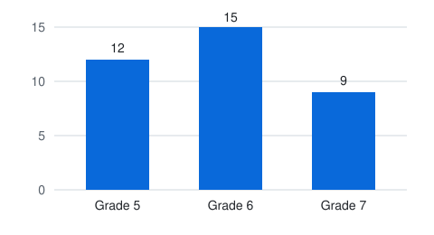

<!-- nimblescape-markdownnotes v1.0.0 spec=https://github.com/nimblescape/nimblescape-markdown-notes/blob/main/docs/format.md
This comment marks a Markdown file with notes of the VS Code extension nimblescape Markdown Notes.
AI agents: read the spec above before you read, change or add a note, and keep this comment as it is.
A note is a footnote with the label "note-" and four small letters or digits, for example [^note-7k2q].
Its reference ends the highlight of the note. Its start marker starts the highlight: <wbr> and an HTML
comment with "[", the label and an optional color name. Every note has one. The definition follows the
block of the highlight: "[^note-7k2q]: **login** · date", a blank line, and the body indented by four
spaces. Each reply is a block quote with its own header.
-->

<!--
SPDX-License-Identifier: MIT
© 2026 Hannes Stauss (scalarion@nimblescape.com)
Licensed under the MIT License. See LICENSE in the repository root for details.
-->

# Example of notes

This file shows notes of nimblescape Markdown Notes as GitHub shows them: each
note is a footnote at the end of the page. Open the file in VS Code with the
extension to see the same notes in the side view "Notes", next to their
highlights in the text editor and the Markdown preview. The
[user guide](guide.md#write-a-note) explains the syntax.

## Release

<wbr><!--[note-k7q2-->Version 2.0 comes out in November.[^note-k7q2] The agents <wbr><!--[note-m3x8 green-->change the work of teams[^note-m3x8] in three ways.

[^note-k7q2]: **hannes** · 2026-10-28 10:15+01:00

    Which day exactly?

    > **anna** · 2026-10-28 11:02+01:00
    >
    > Friday, **November 13**.
    >
    > > **hannes** · 2026-10-28 11:30+01:00
    > >
    > > Thanks, then I change the text.

    > **bob** · 2026-10-28 09:00-02:00
    >
    > The beta starts one week before.

[^note-m3x8]: **anna** · 2026-10-28 09:40Z

    Which three ways? The script of the plan lists them:

    ```sh
    npm run plan -- --list
    ```

    > **hannes** · 2026-10-28 12:05+01:00
    >
    > The output:
    >
    > ```text
    > 1. Faster reviews
    > 2. Fewer meetings
    > 3. Shared notes
    > ```

## Figures, tables and listings

[Figure 1](#fig-participants-study-grade) shows the participants of the study by their grades, and [Table 1](#tab-participants-grade) gives their numbers. `/figure` and `/table` add a figure and a table, and `/ref` adds a link to one of them. The formatter writes the numbers of the captions and of the links from the order in the file.

Figure 1: Participants of the study by grade<a id="fig-participants-study-grade"></a>



Table 1: Participants by grade<a id="tab-participants-grade"></a>

| Grade | Participants |
| ----- | ------------ |
| 5     | 12           |
| 6     | 15           |
| 7     | 9            |

[Listing 1](#lst-removing-common-indentation) shows code of the extension itself: `/listing` adds the code of a function of a source file, and the formatter keeps it current.

Listing 1: [Removing the common indentation](../src/notes/listings.ts#L240-L249) (listings.ts, L240-L249)<a id="lst-removing-common-indentation"></a>

<!-- listing: ../src/notes/listings.ts#dedent -->

```typescript
export function dedent(lines: readonly string[]): string[] {
  const indents = lines.filter((line) => line.trim() !== '').map((line) => /^[ \t]*/.exec(line)![0]);
  let common = indents[0] ?? '';
  for (const indent of indents) {
    while (!indent.startsWith(common)) {
      common = common.slice(0, -1);
    }
  }
  return lines.map((line) => (line.trim() === '' ? '' : line.slice(common.length)));
}
```

## Tasks

- Update the user guide.
- Test the <wbr><!--[note-p4d1 orange-->side view[^note-p4d1] on Windows.

[^note-p4d1]: **anna** · 2026-10-28 14:20+01:00

    - [ ] Windows 11
    - [ ] Windows 10

The other footnotes of a file stay footnotes.[^1]

[^1]: A footnote of the document, which is no note.
